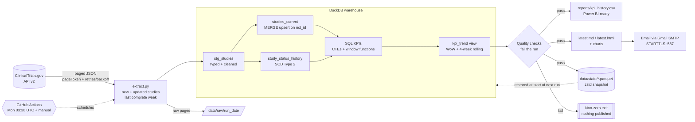
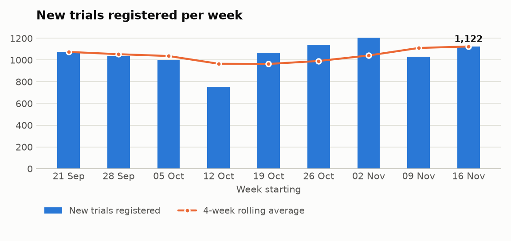

# Automated KPI Reporting Pipeline

[](https://github.com/PiyushDas-2004/automated-kpi-reporting-pipeline/actions/workflows/weekly-kpi.yml)

A weekly GitHub Actions pipeline that pulls fresh clinical-trial data from the public
**ClinicalTrials.gov API v2**, loads it incrementally into **DuckDB**, computes weekly KPIs in
**SQL**, blocks bad data with **quality checks**, and publishes a **Power BI-ready dataset**, a
**Markdown/HTML report with charts**, and a **summary email**. Nobody has to touch it.

It replaces a manual weekly reporting task: pull data, update the spreadsheet, rebuild the charts
and write the summary email.

**Latest report:** [`reports/latest.md`](reports/latest.md) · **KPI dataset:** [`reports/kpi_history.csv`](reports/kpi_history.csv) · **Design decisions and interview prep:** [`docs/DECISIONS.md`](docs/DECISIONS.md)

---

## The manual process this replaces

This is a typical weekly "clinical trial landscape" update done by hand by an analyst using the
ClinicalTrials.gov website and Excel:

| # | Manual step | What it involves | Time (est.) |
|---|---|---|---:|
| 1 | Pull data | Run two searches on ClinicalTrials.gov (studies *first posted* and studies *updated* in the last 7 days), export both to CSV, merge them and remove the overlap | 45 min |
| 2 | Clean | Fix mixed date formats (`2026-11` vs `2026-11-05`), split multi-value cells (phases, conditions, site countries), remove duplicates | 60 min |
| 3 | Update the master spreadsheet | Use VLOOKUP against last week's tab to spot status changes, append new trials, overwrite changed rows, and keep a manual "status log" | 60 min |
| 4 | Recalculate KPIs | Rebuild pivots by phase, sponsor class, condition and country, compute medians, then work out week-over-week and 4-week averages by hand | 45 min |
| 5 | Rebuild charts | Refresh 3–4 charts and paste them into the report or deck | 30 min |
| 6 | QA | Spot-check totals against the website, fix broken formulas and ranges that didn't extend to new rows | 30 min |
| 7 | Write and send the email | Decide what "changed" this week, write the summary and send it to the distribution list | 30 min |
| | **Total** | | **≈ 5 h / week (≈ 250 h / year)** |

The steps are also error-prone: copy-paste mistakes, VLOOKUPs that miss renamed rows, no audit
trail of status changes, and a report that depends on one person being available on Monday morning.

**Automated:** the same work now runs on a schedule in about **1–2 minutes** of compute (the local
end-to-end run is about 10 s, mostly polite API paging). It is fully reproducible (raw API pages
are saved, versions are pinned), has a status history, and fails loudly instead of sending wrong
numbers. The analyst's job becomes reading the email.

---

## Architecture



Run order (`pipeline/run.py`): **restore snapshot → extract → load/transform → quality checks →
publish (CSV + report + charts) → save snapshot → email**. The whole load/transform step for a week
runs in one DuckDB transaction, so it either completes fully or changes nothing.

---

## Sample report (excerpt)

From [`reports/latest.md`](reports/latest.md). The report is regenerated every Monday, so the
numbers below are a snapshot of the seeded week of 9–15 Nov 2026.

> **Headline KPIs**
>
> | KPI | This week | vs last week | 4-wk avg |
> |---|---:|---:|---:|
> | New trials registered | **1,028** | ▼ -177 (-14.7%) vs last week | 1,110 |
> | Industry-sponsored share of new trials | **15.2%** | ▲ +0.4 pts vs last week | 15.3% |
> | Median planned enrollment (new trials) | **90** | ▲ +10 (+12.5%) vs last week | 86 |
> | New trial sites | **2,088** | ▼ -302 (-12.6%) vs last week | 2,124 |
>
> **3 things that changed this week**
> 1. New trial registrations fell 15% week over week (1,205 → 1,028), below the 4-week average of 1,110.
> 2. New Phase 2/3 registrations rose 50% week over week (8 → 12), above the 4-week average of 10 (overall: -15%).
> 3. New trials in Anxiety rose 23% week over week (13 → 16), above the 4-week average of 13.5 (overall: -15%).



The "3 things" are chosen automatically. Week-over-week moves are ranked by a Poisson z-score,
`(this − last) / √(this + last)`, which favours moves that are both large and unlikely to be noise.
Breakdown rows are mix-adjusted against the total, so a segment that simply followed the overall
trend doesn't crowd out a segment that actually moved differently. See
[DECISIONS.md](docs/DECISIONS.md#7-other-design-choices).

---

## KPIs

All KPIs are stored in long format: one row per **week × kpi_name × dimension × dimension_value**.

| kpi_name | dimension(s) | Definition |
|---|---|---|
| `new_trials` | total, phase, sponsor_class, study_type, condition_top10 | Studies whose **first post date** falls in the week |
| `industry_share_new_trials_pct` | total | % of new trials whose lead sponsor class is INDUSTRY |
| `updated_trials` | total, current_status | Studies with a **last update post date** in the week, by current status |
| `status_changes` | total, to_status | Status transitions confirmed by the SCD2 history (previous → new status) |
| `stopped_trials` | total, stop_reason | Updated studies now TERMINATED / WITHDRAWN / SUSPENDED, with `whyStopped` grouped into reason categories |
| `median_planned_enrollment` | total, phase | Median enrollment of new trials whose enrollment type is ESTIMATED (planned) |
| `new_trial_sites` | total, country_top10 | Number of sites (locations) listed on new trials, top 10 countries |
| `countries_with_new_sites` | total | Distinct countries among those sites |

Every series also has `prev_week_value`, `wow_change`, `wow_pct`, `rolling_4wk_avg` and
`weeks_in_rolling_avg`, computed in SQL with window functions ([`sql/50_kpi_trend.sql`](sql/50_kpi_trend.sql)).

### Loading into Power BI

*Get Data → Text/CSV →* `reports/kpi_history.csv` (or use the raw GitHub URL for a refreshable
source). Set `week_start` to Date and `value` to Decimal number, then build visuals by filtering
on `kpi_name` and `dimension` (for example, a line chart of `value` by `week_start` with
`kpi_name = new_trials` and `dimension = total`). `is_backfill` and `pipeline_version` support
lineage filtering.

---

## Data model (DuckDB)

| Table | Grain | Purpose |
|---|---|---|
| `stg_studies` | one row per study in this run | Typed, cleaned, de-duplicated extract (rebuilt every run) |
| `studies_current` | one row per `nct_id` | Latest known version of each study, kept up to date with `MERGE` |
| `study_status_history` | one row per study × status period | SCD Type 2: `valid_from`, `valid_to` (exclusive, open = 9999-12-31), `is_current`, `previous_status` |
| `kpi_weekly` | week × KPI × dimension value | KPI values, replaced for the run's week on every run |
| `kpi_trend` (view) | same as `kpi_weekly` | Adds week-over-week change and 4-week rolling average |
| `pipeline_runs` | one row per run | Audit trail: rows extracted, inserted, updated, status changes |
| `dim_*` | reference | Phase groups, sponsor classes, statuses and stop reasons, so zero counts appear as explicit zeros instead of missing rows |

---

## Repository layout

```
pipeline/            Python orchestration (no business logic hidden in Python)
  extract.py         API paging, retries/backoff, raw page archive, field flattening
  transform.py       runs the SQL files in order inside one transaction
  quality.py         quality gate (raises -> run fails)
  state.py           parquet snapshot restore/save between Actions runs
  report.py          CSV dataset, "3 things that changed", Jinja2 rendering
  charts.py          matplotlib charts
  emailer.py         SMTP (STARTTLS) email, secrets from env only
  run.py             CLI entry point + structured logging + exit codes
sql/                 all transformations and KPIs (CTEs, window functions, MERGE, SCD2)
templates/           Jinja2 templates for latest.md / latest.html
tests/               pytest suite (54 tests, API fully mocked)
reports/             published outputs (committed by the bot every week)
data/state/          compressed parquet snapshot of warehouse state (committed)
docs/DECISIONS.md    design decisions + interview Q&A
.github/workflows/   weekly-kpi.yml
```

---

## Run it locally

Requires Python 3.11 and `make`.

```bash
make setup          # create .venv and install pinned requirements (+ pytest)
make test           # run the 54 tests (no network needed)
make run            # run the weekly pipeline for the last complete week
make run-no-email   # same, without the email step
make backfill WEEKS=8            # (re)seed history for the 8 weeks before the target week
make replay DATE=2026-11-23      # re-process saved raw pages without calling the API
make help
```

Outputs go to `reports/`; raw API pages go to `data/raw/<run_date>/` (git-ignored); the local
warehouse is `data/warehouse.duckdb` (git-ignored, rebuilt from `data/state/` when missing).
Every path can be redirected with `KPI_DATA_DIR`, `KPI_REPORTS_DIR` and `KPI_LOG_DIR`.

To test the email locally, export the three variables first. Never put them in a committed file;
`.env` is git-ignored.

```bash
export SMTP_USER="you@gmail.com" SMTP_PASS="your-16-char-app-password" REPORT_TO="a@x.com,b@y.com"
make run
```

---

## GitHub Actions setup

The workflow [`.github/workflows/weekly-kpi.yml`](.github/workflows/weekly-kpi.yml) runs **every
Monday at 03:30 UTC (09:00 IST)** and on demand (*Actions → Weekly KPI refresh → Run workflow*,
optionally with a run date). It sets up Python 3.11 with a pip cache, runs the tests, runs the
pipeline, writes the headline KPIs to the job summary, uploads the HTML report and the log as
artifacts, and commits `reports/` and `data/state/` back with
`chore: weekly KPI refresh YYYY-MM-DD`. If anything fails, the job goes red, the error appears as
an annotation, and the last log lines are written to the job summary.

### Add the 3 secrets (needed for the email)

1. Create a Gmail **app password**: Google Account → Security → turn on 2-Step Verification →
   *App passwords* → create one called "KPI pipeline" and copy the 16-character password.
2. In the GitHub repo: **Settings → Secrets and variables → Actions → New repository secret**, and add:

| Secret | Value |
|---|---|
| `SMTP_USER` | the Gmail address that sends the report |
| `SMTP_PASS` | the app password from step 1 (not your normal password) |
| `REPORT_TO` | comma-separated recipient list |

Without these, the pipeline still runs and publishes; it logs
`email skipped: SMTP settings not configured` and the job stays green.

---

## Known limitations

- **Point-in-time KPIs can't be backfilled.** The API returns only the *latest* version of each
  study, so "updated this week" and "stopped this week" are recorded only by live weekly runs. The
  8 seeded weeks have exact new-registration KPIs (first-post dates never change), but no
  update-based KPIs.
- **Confirmed status changes start at zero.** SCD2 can only detect a change once it has seen a
  study before, so this KPI grows as weekly runs accumulate history.
- **Stop-reason categories** come from transparent keyword rules on the free-text `whyStopped`
  field (see `sql/42_kpi_status_changes.sql`). They are good for trends, not a clinical
  adjudication.
- The snapshot grows by about 0.3–0.5 MB a week. [DECISIONS.md](docs/DECISIONS.md#5-state-persistence-between-github-actions-runs)
  covers when to move it to object storage.

---

## Suggested resume bullet

> Built an automated weekly KPI pipeline (Python, DuckDB SQL, GitHub Actions) that ingests ClinicalTrials.gov API data, applies idempotent upserts and SCD2 status history, enforces data-quality gates, and publishes Power BI-ready datasets, charts and email reports.
