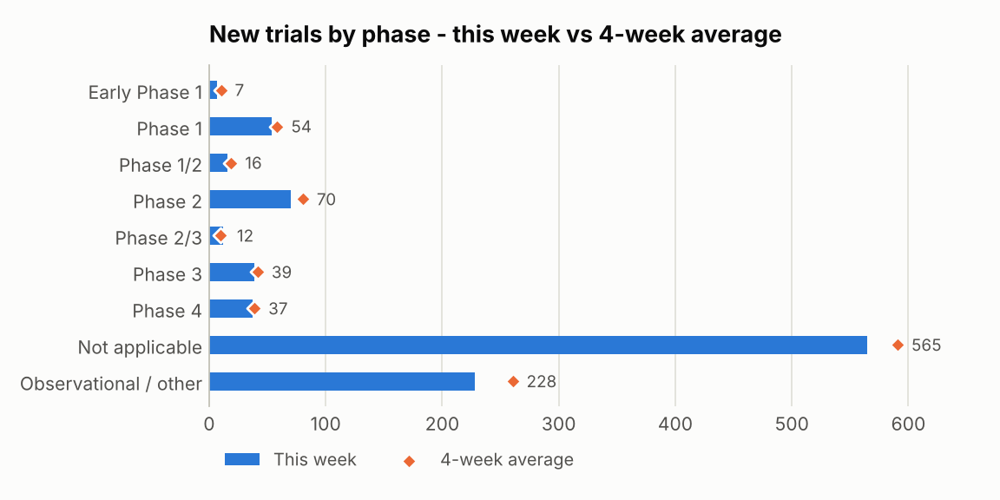
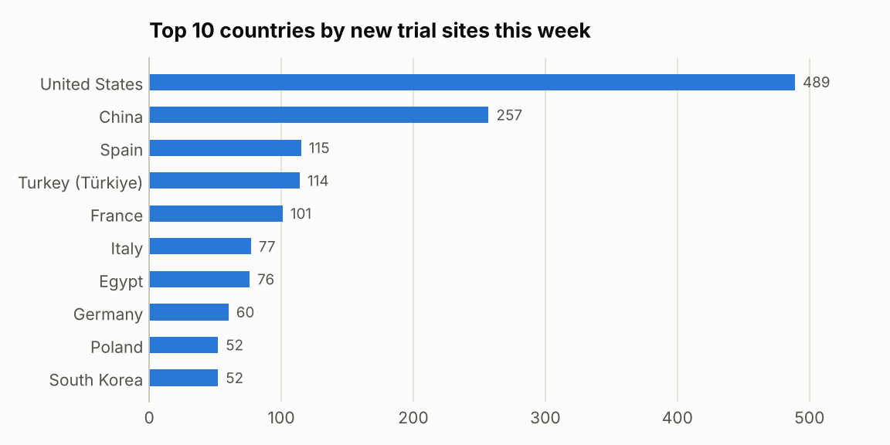

# Weekly Clinical Trials KPI Report

**Week of 09 Nov 2026 - 15 Nov 2026** · source: ClinicalTrials.gov API v2 · run date 2026-11-16 · generated 2026-11-24 15:02 UTC

## Headline KPIs

| KPI | This week | vs last week | 4-wk avg |
|---|---:|---:|---:|
| New trials registered | **1,028** | ▼ -177 (-14.7%) vs last week | 1,110 |
| Confirmed status changes | **0** | ▬ +0 vs last week | 0 |
| Industry-sponsored share of new trials | **15.2%** | ▲ +0.4 pts vs last week | 15.3% |
| Median planned enrollment (new trials) | **90** | ▲ +10 (+12.5%) vs last week | 86 |
| New trial sites | **2,088** | ▼ -302 (-12.6%) vs last week | 2,124 |

## 3 things that changed this week

1. New trial registrations fell 15% week over week (1,205 → 1,028), below the 4-week average of 1,110.
2. New Phase 2/3 registrations rose 50% week over week (8 → 12), above the 4-week average of 10 (overall: -15%).
3. New trials in Anxiety rose 23% week over week (13 → 16), above the 4-week average of 13.5 (overall: -15%).

## Charts

## New registrations by phase

| Phase | New trials | WoW | 4-wk avg | Median planned enrollment |
|---|---:|---:|---:|---:|
| Early Phase 1 | 7 | ▬ +0 | 10.2 | 20 |
| Phase 1 | 54 | ▼ -19 | 58.5 | 42 |
| Phase 1/2 | 16 | ▼ -3 | 19 | 68 |
| Phase 2 | 70 | ▼ -22 | 80.5 | 86 |
| Phase 2/3 | 12 | ▲ +4 | 10 | 178 |
| Phase 3 | 39 | ▼ -5 | 41.8 | 312 |
| Phase 4 | 37 | ▼ -6 | 39 | 95 |
| Not applicable | 565 | ▼ -91 | 591 | 75 |
| Observational / other | 228 | ▼ -35 | 260 | 200 |

## By sponsor class

| Sponsor class | New trials | WoW | 4-wk avg |
|---|---:|---:|---:|
| OTHER | 819 | ▼ -146 | 884 |
| INDUSTRY | 156 | ▼ -22 | 170 |
| OTHER_GOV | 39 | ▼ -9 | 40 |
| UNKNOWN | 5 | ▲ +1 | 4.2 |
| FED | 4 | ▲ +3 | 3.5 |
| NETWORK | 3 | ▼ -3 | 6 |
| NIH | 2 | ▼ -1 | 3 |

## Top 10 conditions (new trials)

| Condition | New trials | WoW |
|---|---:|---:|
| Anxiety | 16 | ▲ +3 |
| Stroke | 15 | ▬ +0 |
| Postoperative Pain | 12 | ▼ -1 |
| Depression | 10 | –  |
| Colorectal Cancer | 8 | –  |
| Multiple Sclerosis | 8 | –  |
| Obesity & Overweight | 8 | –  |
| Pain | 8 | –  |
| Breast Cancer | 7 | ▼ -4 |
| Cancer | 7 | –  |

## Status changes and stopped trials

_No confirmed (SCD2) status transitions were detected this week._

_Stopped-trial counts are point-in-time and are not reported for backfilled weeks._

## Top countries by new trial sites

| Country | New sites | WoW |
|---|---:|---:|
| United States | 489 | ▼ -1 |
| China | 257 | ▼ -230 |
| Spain | 115 | ▲ +54 |
| Turkey (Türkiye) | 114 | ▼ -15 |
| France | 101 | ▲ +9 |
| Italy | 77 | ▼ -39 |
| Egypt | 76 | ▲ +8 |
| Germany | 60 | –  |
| Poland | 52 | –  |
| South Korea | 52 | –  |

## Notes

- Confirmed status changes come from the SCD2 history: a change is only counted once a study has been seen before with a different status. The count grows as the warehouse accumulates weekly snapshots.
- This week was loaded after the fact (backfill), so point-in-time KPIs (registry updates, stopped trials) are not reported for it.
- Planned enrollment uses trials whose enrollment type is ESTIMATED. Month-only registry dates are normalised to the 1st of the month.

_Automated KPI Reporting Pipeline v1.0.0 · 8 week(s) of history · full dataset: [kpi_history.csv](kpi_history.csv)_