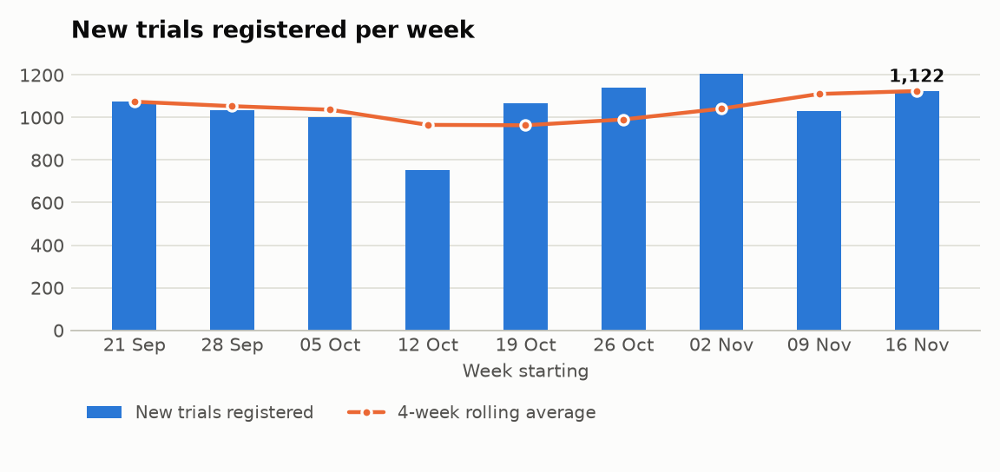

# Weekly Clinical Trials KPI Report

**Week of 16 Nov 2026 - 22 Nov 2026** · source: ClinicalTrials.gov API v2 · run date 2026-11-24 · generated 2026-11-24 18:38 UTC

## Headline KPIs

| KPI | This week | vs last week | 4-wk avg |
|---|---:|---:|---:|
| New trials registered | **1,122** | ▲ +94 (+9.1%) vs last week | 1,124 |
| Trials with a registry update | **5,300** | – no prior week | 5,300 |
| Confirmed status changes | **0** | ▬ +0 vs last week | 0 |
| Updated trials now terminated / withdrawn / suspended | **154** | – no prior week | 154 |
| Industry-sponsored share of new trials | **15.3%** | ▲ +0.1 pts vs last week | 15.5% |
| Median planned enrollment (new trials) | **80** | ▼ -10 (-11.1%) vs last week | 83.5 |
| New trial sites | **1,617** | ▼ -471 (-22.6%) vs last week | 2,038 |

## 3 things that changed this week

1. New trial registrations rose 9% week over week (1,028 → 1,122), in line with the 4-week average of 1,124.
2. New Phase 1/2 registrations rose 69% week over week (16 → 27), above the 4-week average of 20.8 (overall: +9%).
3. New trials in Stroke fell 33% week over week (15 → 10), below the 4-week average of 13 (overall: +9%).

## Charts

## New registrations by phase

| Phase | New trials | WoW | 4-wk avg | Median planned enrollment |
|---|---:|---:|---:|---:|
| Early Phase 1 | 6 | ▼ -1 | 8.5 | 40 |
| Phase 1 | 67 | ▲ +13 | 64 | 36 |
| Phase 1/2 | 27 | ▲ +11 | 20.8 | 72 |
| Phase 2 | 75 | ▲ +5 | 79.5 | 54.5 |
| Phase 2/3 | 8 | ▼ -4 | 9.2 | 180 |
| Phase 3 | 36 | ▼ -3 | 41.8 | 394 |
| Phase 4 | 33 | ▼ -4 | 40 | 130 |
| Not applicable | 613 | ▲ +48 | 606 | 68 |
| Observational / other | 257 | ▲ +29 | 254 | 150 |

## By sponsor class

| Sponsor class | New trials | WoW | 4-wk avg |
|---|---:|---:|---:|
| OTHER | 882 | ▲ +63 | 892 |
| INDUSTRY | 172 | ▲ +16 | 174 |
| OTHER_GOV | 54 | ▲ +15 | 43.5 |
| NETWORK | 5 | ▲ +2 | 5.5 |
| NIH | 4 | ▲ +2 | 2.8 |
| UNKNOWN | 3 | ▼ -2 | 3.5 |
| FED | 2 | ▼ -2 | 3 |

## Top 10 conditions (new trials)

| Condition | New trials | WoW |
|---|---:|---:|
| Anxiety | 18 | ▲ +2 |
| Obesity | 17 | –  |
| Postoperative Pain | 15 | ▲ +3 |
| Breast Cancer | 11 | ▲ +4 |
| Stroke | 10 | ▼ -5 |
| Prostate Cancer | 9 | –  |
| Healthy Volunteers | 7 | –  |
| Heart Failure | 7 | –  |
| Overweight | 7 | –  |
| Sepsis | 7 | –  |

## Status changes and stopped trials

_No confirmed (SCD2) status transitions were detected this week._

**Why trials stopped** (updated this week, now terminated / withdrawn / suspended)

| Reason category | Trials | WoW | 4-wk avg |
|---|---:|---:|---:|
| Business / funding decision | 57 | –  | 57 |
| Low enrollment / recruitment | 39 | –  | 39 |
| Other | 25 | –  | 25 |
| Study team / site / logistics | 17 | –  | 17 |
| Safety / efficacy | 12 | –  | 12 |
| COVID-19 | 3 | –  | 3 |
| Not provided | 1 | –  | 1 |

**Notable stopped trials**

| Trial | Status | Sponsor | Reason given |
|---|---|---|---|
| [NCT04172766](https://clinicaltrials.gov/study/NCT04172766) Apple Hearing Study | TERMINATED | Apple Inc. | sponsor termination of research funding |
| [NCT03513549](https://clinicaltrials.gov/study/NCT03513549) Observational Study Evaluating the Safety of ADASUVE® in Agitation... | SUSPENDED | Nova Pneuma Inc. | Low commercial usage of ADASUVE resulting in low patient enrollment. NPI has placed this study... |
| [NCT05600777](https://clinicaltrials.gov/study/NCT05600777) A 24-Week Study of the Efficacy and Safety of BLU-5937 in Adults... | TERMINATED | Bellus Health Inc. - a GSK company | The study has been terminated due to the decision to cease further development of camlipixant in... |
| [NCT04428151](https://clinicaltrials.gov/study/NCT04428151) Lenvatinib (E7080/MK-7902) in Combination With Pembrolizumab... | TERMINATED | Merck Sharp & Dohme LLC | Business Reasons |
| [NCT06775379](https://clinicaltrials.gov/study/NCT06775379) A Randomized Study of Azetukalner Versus Placebo in Major... | TERMINATED | Xenon Pharmaceuticals Inc. | See Xenon's September 17, 2026 press release providing an update on its psychiatry clinical... |
| [NCT02227251](https://clinicaltrials.gov/study/NCT02227251) Selinexor (KPT-330) in Patients With Relapsed/Refractory Diffuse... | TERMINATED | Karyopharm Therapeutics Inc | Terminated in alignment with FDA agreement to withdraw accelerated approval of DLBCL indication.... |
| [NCT05348915](https://clinicaltrials.gov/study/NCT05348915) A Study to Evaluate the Long-term Safety of Inclacumab... | TERMINATED | Pfizer | Sponsor decision to terminate study based on results of parent study GBT2104-131. |
| [NCT05655299](https://clinicaltrials.gov/study/NCT05655299) VTX958 Versus Placebo for the Treatment of Moderate to Severe Psoriasis | TERMINATED | Ventyx Biosciences, Inc | Business Decision |

## Top countries by new trial sites

| Country | New sites | WoW |
|---|---:|---:|
| China | 293 | ▲ +36 |
| United States | 257 | ▼ -232 |
| France | 169 | ▲ +68 |
| Turkey (Türkiye) | 148 | ▲ +34 |
| Italy | 93 | ▲ +16 |
| Egypt | 76 | ▬ +0 |
| Spain | 65 | ▼ -50 |
| Brazil | 46 | –  |
| Canada | 43 | –  |
| South Korea | 40 | ▼ -12 |

## Notes

- Confirmed status changes come from the SCD2 history: a change is only counted once a study has been seen before with a different status. The count grows as the warehouse accumulates weekly snapshots.
- Planned enrollment uses trials whose enrollment type is ESTIMATED. Month-only registry dates are normalised to the 1st of the month.

_Automated KPI Reporting Pipeline v1.0.0 · 9 week(s) of history · full dataset: [kpi_history.csv](kpi_history.csv)_